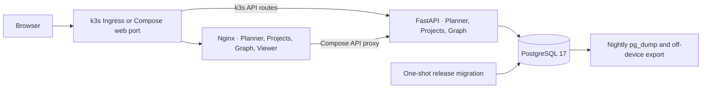

# Day Planner architecture

Day Planner is a personal tool for daily planning, project management,
graph notes, and local Markdown and Mermaid previews. The design assumes one
primary user and up to five concurrent users. Production means a single k3s
node on a repurposed laptop with limited CPU and memory. Workstation
development can use Docker Compose or native frontend and API processes.
Maintenance downtime is acceptable. Recoverable data is more important
than uninterrupted availability.

## Components

| Component | Responsibility |
| --- | --- |
| `web/` | React Planner and Projects views, shared navigation and API client, and responsive frontend domain helpers. |
| `obsidian-arrow/` | Independently buildable Graph editor. Hosted mode uses the suite API. Standalone mode retains its own storage adapters. |
| `viewer/` | Browser-side Markdown and Mermaid rendering at `/viewer/`. Source files stay in the browser. |
| `app_planner/`, `app_projmgmt/`, `app_graph/` | One FastAPI application. Routers handle HTTP, services enforce application rules, and persistence modules use SQL through psycopg. The Textual client shares Planner and Projects application code. |
| Nginx | Serves all hosted static bundles from one image. Compose also uses it as the same-origin API proxy. Independent frontend builds preserve local development workflows. |

## Storage and changes

PostgreSQL stores Planner entries and their project links, project cards and
activity, the shared Graph document, and Graph attachment bytes. A Graph save
checks the revision and stores document and attachment changes in one
transaction. Most API operations use short-lived psycopg connections scoped
to the operation. Database configuration comes from the environment.
Optional `DATABASE_SCHEMA` isolates schemas for development and tests.

Versioned SQL has one migration runner. The k3s release Job and Compose
migration service run that command before application rollout. Workstation
commands can run `just db-migrate` explicitly. API startup and ordinary
connections do not modify schema. Prefer additive SQL that lets the previous
API serve traffic while migrations run and supports image rollback. Plan
schema-incompatible changes as maintenance and document recovery before
shipping them.

## Deployment and recovery

Compose uses a named database volume and builds the same two application image
targets as CI. K3s uses single-replica Deployments and Services for web and API,
an Ingress, a ConfigMap for the web proxy upstream, and a Secret for database
settings. The PostgreSQL StatefulSet owns the data PVC. Resources, probes,
and deliberate rollout checks fit a single node. Keep access on a trusted
network or behind an authenticated HTTPS boundary.

CI runs Python lint and PostgreSQL tests, frontend builds, type checking,
unit tests, browser smoke tests, and Kustomize validation. Tagged releases
publish versioned images to GHCR. The operator deploys a matching tagged
Kustomize overlay pinned to the published digests. The cluster is updated
through an explicit context with preflight, migration, and rollout checks.
See the [deployment and recovery runbook](deploy/k3s/README.md).

Nightly PostgreSQL archives provide quick recovery. Schedule copies on
separate storage, keep deployment configuration and credentials recoverable,
and rehearse restoration into disposable PostgreSQL. Verify representative
data and attachment downloads. Monitor scheduled completion and off-device
freshness independently of restore rehearsals.

## Decisions and non-goals

Keep features in existing domain modules where practical. Add a deployment
boundary when it has a distinct runtime or operational requirement. Prefer
PostgreSQL transactions and Kubernetes primitives. Justify dependencies,
abstractions, and resource increases with a concrete problem. Keep Compose
and k3s compatible by injecting deployment configuration at runtime.

Multi-tenancy, horizontal scaling, highly available or distributed
PostgreSQL, multiple regions, public SaaS operation, and zero-downtime
maintenance are outside the project scope.
