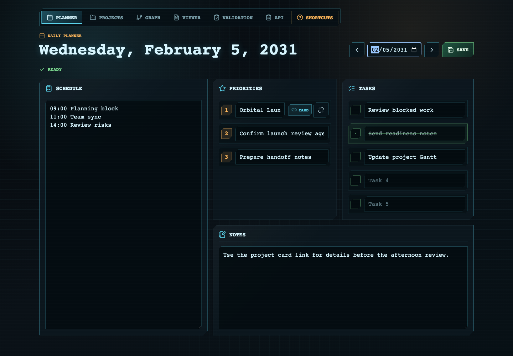
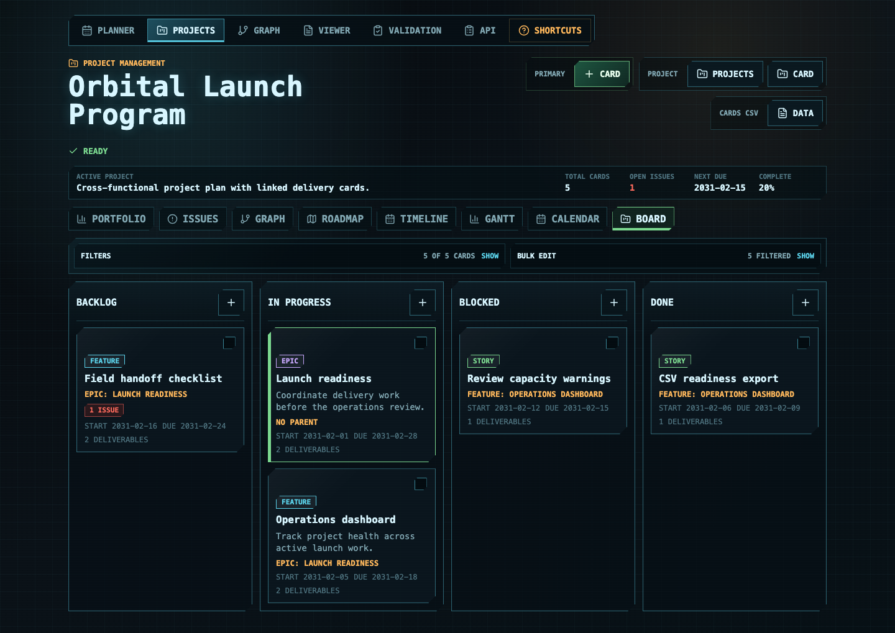
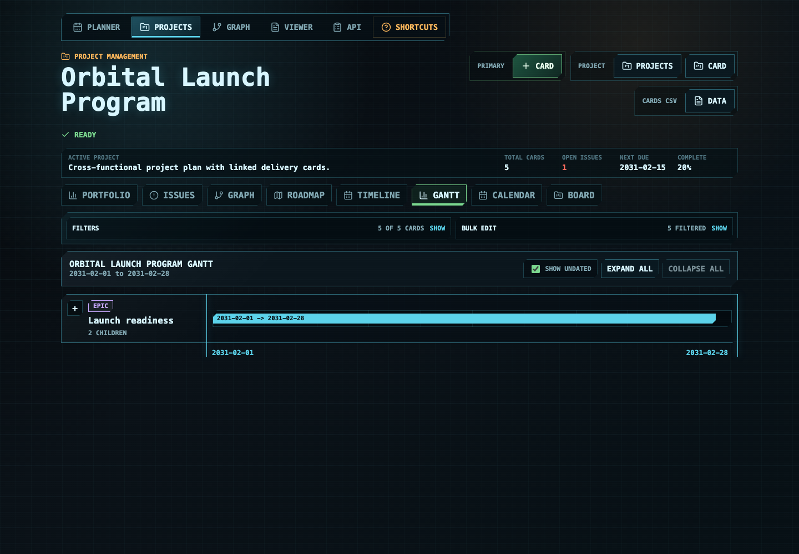
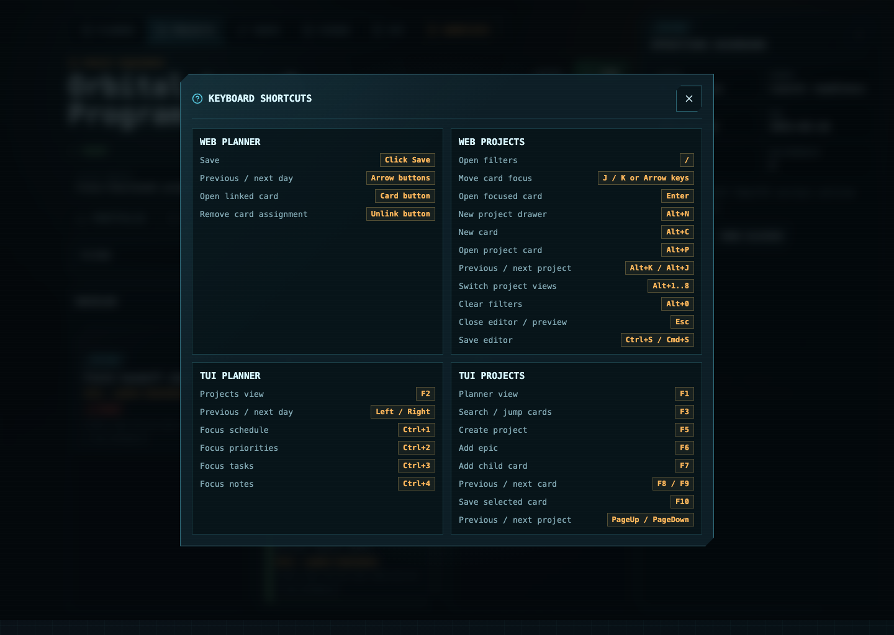
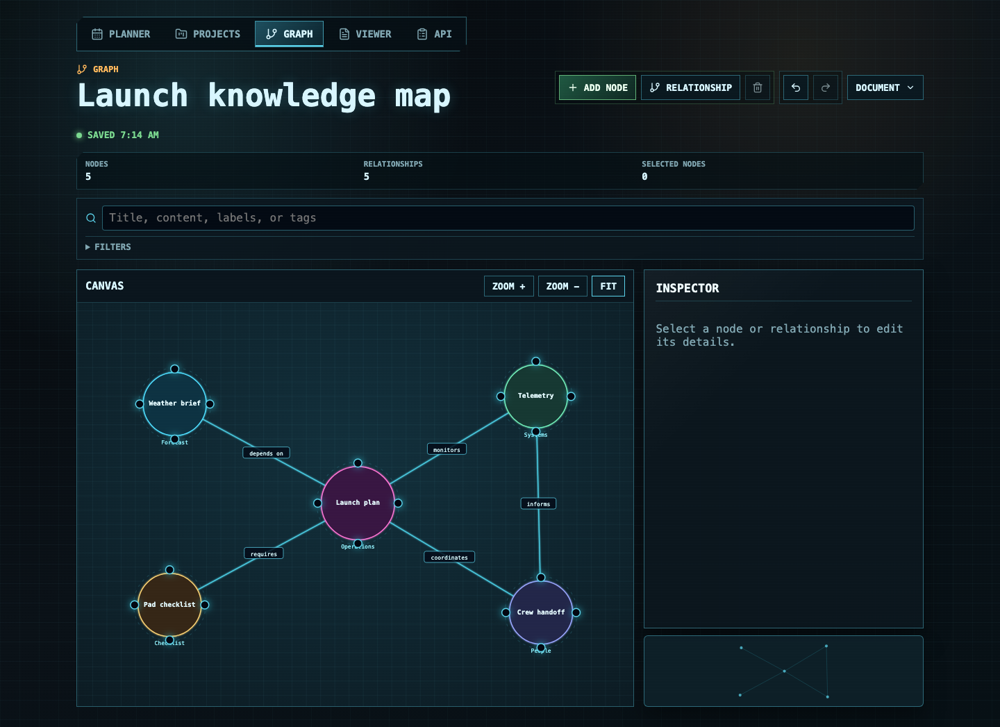

# Daily Planner

A daily planner, project workspace, visual wiki, and Markdown and Mermaid viewer. The web app brings together Planner, Projects, Graph, and Viewer. The Python [Textual](https://textual.textualize.io/) TUI provides access to Planner and Projects. The planner is inspired by the Sidekick layout and gives each day a schedule, priorities, tasks, and notes.

## Features

- Daily planner view with schedule, priorities, tasks, and notes sections
- Three daily priority fields
- Five task fields with completion checkboxes
- Previous/next day navigation
- Postgres persistence for planner and project management data
- Textual TUI and React web interfaces backed by the same Postgres database
- Project management workspace with projects, epics, features, stories, subtasks, start dates, due dates, statuses, and deliverables
- Card-level project hierarchy: epics contain features, features contain stories, and stories contain subtasks
- Project cards with linked epics and quick epic creation
- Portfolio, roadmap, timeline, Gantt, calendar, and board views for project work
- Drag-and-drop Kanban status updates in the web project board
- Planner assignment warnings for full future days and already scheduled card priorities
- Card comments with Markdown preview and Mermaid/MMD fenced block support
- Project deletion from the Projects sidebar
- FastAPI JSON API for web access
- Docker Compose hosting with a persisted Postgres database
- Optional standalone executable build with PyInstaller

## Graph

Open **Graph** from the web navigation or go directly to `/graph/`. Use it to
organize notes and reference material as nodes, then draw relationships to show
how they connect.

- Write node content in Markdown, link to other nodes, and follow backlinks.
- Attach reference files and find nodes by title, content, label, or tag.
- Pan and zoom the canvas, use the minimap, and arrange groups of nodes in a grid or circle.

Hosted Graph autosaves one shared graph and its attachments to Postgres. Open
the same deployment from another browser to pick up where you left off. If a
stale tab tries to save over a newer revision, Graph asks you to export your
edits and reload. The standalone version stores data in the browser.

The workspace summary shows node, relationship, and selection counts. Use the
search and filters above the canvas to find nodes. Open **Document** to rename
the graph or find the import, export, and backup actions. Use
**Export backup** to make a portable copy with attachment files and **Import JSON**
to bring it into a deployment. **Export JSON** carries the graph
and attachment metadata. Hosted attachments can be up to 10 MiB each, and a
single save or import request can be up to 24 MiB. See the
[migration steps](deploy/k3s/README.md#move-an-existing-graph) for existing graphs.

## Markdown and Mermaid Viewer

Open **Viewer** from the web navigation or go to `/viewer/`. It starts in
**Mermaid** with a rendered flowchart. Use **Diagram type** to load an editable
example, such as a sequence diagram, Gantt chart, or mind map. Edits stay in
their own draft while you switch diagram types or formats in the open tab.
Use **Expand preview** in the Preview header to span both panes. Select
**Restore split view** or press `Esc` to bring the editor back.
Use the zoom buttons or `Ctrl`/`Cmd` + scroll to zoom the preview. Turn on
**Pan preview** and drag to scan around it. **Fit** resets the view and shrinks
a tall standalone diagram to fit the pane.

Select **Markdown** or open a local `.md` file for a live Markdown preview.
Use a `mermaid` or `mmd` fenced code block to embed a diagram. Open an `.mmd`
or `.mermaid` file to preview its source as a standalone diagram.

The viewer renders in the browser and does not upload or save your source.
Raw HTML and external images are disabled in the preview. Keep your source in
a local file if you want to use it again.

## Screenshots













## Quickstart

### Local Container Hosting

On another computer with Docker or Podman installed:

```bash
cp .env.example .env
just host-start
```

Open `http://localhost:8080` and use the top navigation. Graph is also
available directly at `/graph/` and Viewer at `/viewer/`. If you used Graph on a different port or
hostname, follow the [graph migration steps](deploy/k3s/README.md#move-an-existing-graph)
to bring over your graph and attachments.

`just host-start` starts web, API, and PostgreSQL in the background. A one-shot
migration service prepares the database before the API starts. Use `just host-up`
for a foreground run, `just host-ps` for status, and
`just host-logs daily-planner-api` to follow API logs. Docker Compose is the
default. To start the suite with Podman Compose:

```bash
CONTAINER_COMPOSE='podman compose' just host-start
```

Docker-specific shortcuts are also available:

```bash
just docker-up
```

Each Compose project uses its own PostgreSQL volume. When upgrading from an
older stack, run `just host-down` with that checkout and then `just host-start`
with the new release and the same Compose project name to reuse the volume. To stop the suite while
keeping the database:

```bash
just host-down
```

Use the matching engine-specific stop command if needed:

```bash
just docker-down
just podman-down
```

To intentionally remove that computer's hosted database, stop with the reset recipe:

```bash
just host-reset
```

Change the host port by editing `.env`:

```bash
DAILY_PLANNER_PORT=8082
```

Without `just`, run the compose tool directly:

```bash
docker compose up --build -d
```

or:

```bash
podman compose up --build -d
```

### Local Development

From the repository root:

```bash
just setup
just db-up
```

Run the web app:

```bash
just dev
```

Open `http://127.0.0.1:5173/` and use the top navigation to switch between
Planner, Projects, Graph, and Viewer. `just dev` builds Graph and Viewer before
starting FastAPI and Vite. After editing either tool, run `just graph-build`
or `just viewer-build` to refresh its bundle. For standalone hot reload, use
`just graph-dev` or `just viewer-dev`.
Press `Ctrl+C` to stop both development servers.

To run the terminal planner instead:

```bash
just tui
```

To see all task shortcuts:

```bash
just
```

### k3s Deployment

The k3s deployment serves the static frontends and API through one Ingress.
It runs PostgreSQL in a StatefulSet with a persistent data volume and a nightly
`pg_dump` CronJob. See the [architecture](ARCHITECTURE.md) and
[k3s deployment guide](deploy/k3s/README.md) for pinned releases, migration,
HTTPS, rollout checks, and off-device recovery. Run `just k3s-render` to
preview the example without connecting to a cluster.

Cluster-wide monitoring should be managed outside this repo. The API exposes `/api/health` for database and schema readiness and `/api/livez` for process liveness.

## Requirements

- Python 3.13 or newer
- Postgres 17 or newer, or Docker/Podman Compose for the included Postgres service
- [uv](https://docs.astral.sh/uv/) for dependency management
- Node.js 22.12 or newer and npm for the frontends
- Optional: [just](https://github.com/casey/just) for the included task shortcuts

## Local Data

The TUI and web app connect to Postgres through `DATABASE_URL`. Root `just` recipes load `.env` when present. If you change `POSTGRES_PORT`, update `DATABASE_URL` and `TEST_DATABASE_URL` for host-side commands. Set `DATABASE_SCHEMA` to isolate tables into a named Postgres schema, which is useful for tests or multiple local environments. For local container hosting, Docker Compose starts Postgres and persists it in the local named volume `daily_planner_postgres_data`. Docker and Podman keep their own local volume stores, so each computer and container engine has separate data by default.

Run `just db-migrate` to prepare PostgreSQL before starting the API or TUI
directly. The `just api`, `just dev`, and `just tui` recipes run the migration
command before launching.

To import existing SQLite data after starting PostgreSQL:

```bash
just migrate-sqlite planner.db project_mgmt.db
```

List available task shortcuts:

```bash
just
```

Run the Python test suite:

```bash
just test
```

Database integration tests require Postgres. With the Compose database running, use:

```bash
just test-postgres
```

Run the focused browser smoke tests. Install Playwright's Chromium runtime once on each development machine:

```bash
just browser-install
just web-typecheck
just web-unit
just web-test
```

The frontend typecheck covers the typed API client and shared frontend contracts. The frontend unit tests cover extracted scheduling and hierarchy logic. The browser tests build all three bundles, migrate an isolated PostgreSQL schema, and start a local API server.

With Postgres running (`just db-up` for local Compose), capture README
screenshots from isolated demo data. The recipe uses `TEST_DATABASE_URL` when
set and otherwise uses `DATABASE_URL`:

```bash
just screenshots
```

Screenshots are written to `docs/screenshots/`.

Continuous integration runs the same core checks on pushes to `main` and pull requests: Ruff, Python tests, frontend build, frontend typecheck, frontend unit tests, and focused Playwright smoke tests with isolated PostgreSQL schemas, and strict validation of the HTTP and TLS Kubernetes manifests.

## APIs and MCP

Open the suite's API Reference for Planner, Projects, Graph, and Viewer
endpoints. The [Validation tool](docs/validation.md) also exposes document,
character, and Python regex operations over HTTP and MCP. See the [MCP guide](docs/mcp.md) for local clients and ChatGPT
connection options.

## Backup And Restore

Export all planner entries, linked priority assignments, projects, cards, and card activity to a portable JSON file:

```bash
just backup
```

Restore replaces the current local planner and project data with the contents of that file:

```bash
just restore
```

Provide a filename when needed:

```bash
just backup backups/workstation.json
just restore backups/workstation.json
```

For a running hosted container, use the matching host recipes. `CONTAINER_COMPOSE='podman compose'` switches the same recipes to Podman:

```bash
just host-backup backups/hosted.json
just host-restore backups/hosted.json
```

These JSON recipes cover Planner and Projects. Use **Export backup** for a
portable Graph copy. A full Postgres dump, including the k3s nightly backup,
covers all three tools and hosted attachment bytes.

## API

The web frontend talks to the FastAPI app through these endpoints:

| Method | Path | Description |
| --- | --- | --- |
| `GET` | `/api/planner/entries/{entry_date}` | Load a planner entry by `YYYY-MM-DD` date |
| `PUT` | `/api/planner/entries/{entry_date}` | Save a planner entry for that date |
| `PUT` | `/api/planner/card-assignments/{card_id}` | Assign or move a card into a dated planner priority slot |
| `DELETE` | `/api/planner/card-assignments/{card_id}` | Remove a linked card assignment from the planner |
| `GET` | `/api/graphs/workspace` | Load the shared graph and its current revision |
| `PUT` | `/api/graphs/workspace` | Save a graph and any new files using the current revision |
| `GET` | `/api/graphs/workspace/attachments/{key}` | Download a stored attachment |
| `GET` | `/api/projmgmt/projects` | List projects |
| `POST` | `/api/projmgmt/projects` | Create a project |
| `DELETE` | `/api/projmgmt/projects/{project_id}` | Delete a project and its cards |
| `GET` | `/api/projmgmt/projects/{project_id}/cards` | List project cards |
| `GET` | `/api/projmgmt/projects/{project_id}/issues` | List server-side dependency and hierarchy schedule warnings |
| `POST` | `/api/projmgmt/cards` | Create an epic, feature, story, or subtask |
| `PUT` | `/api/projmgmt/cards/{card_id}` | Update a card |
| `DELETE` | `/api/projmgmt/cards/{card_id}` | Delete a card |

## Project Cards

Project cards follow this hierarchy:

```text
Project
  Epic
    Feature
      Story
        Subtask
```

In the Projects tab, opening a project card shows linked epics and an inline field for adding epics without leaving the project card. Opening an epic, feature, or story card shows its parent, child cards, valid parent choices, and an inline field for adding the next child type. Type a child card name and press `Enter` or click `Add`; the child is added to the list and the parent card stays open so multiple child cards can be created quickly. The API enforces the same hierarchy, so a story must be tied to a feature and a subtask must be tied to a story.

Assigning a project card to a planner date creates a linked priority entry. Assigning the same card again moves that priority assignment to the new date. The card editor shows how many priority slots are already used for the selected date, warns when the day is full, and surfaces when multiple linked cards are already assigned to that date. In the web planner, the small linked-card control opens its project card and the adjacent unlink control removes the assignment.

The Cards CSV panel exports the active project's cards, downloads a blank import template, and imports cards from CSV. Imports are validated before any cards are created: row-level errors are shown in the side panel for missing parents, unsupported types or statuses, invalid date ranges, duplicate imported card IDs, and unresolved dependencies. Parent and dependency links can reference existing or imported cards by ID, or by title when the title is unambiguous. If an API failure happens after card creation starts, the web app attempts to roll back the cards created by that import and reloads the project.

Project hierarchy, dependency, and schedule-warning rules are implemented server-side in the project management service layer. The web UI keeps matching local domain helpers for responsive rendering, and the API exposes project issue results for clients that need the server as the source of truth.

## Platform Notes

| Service | Routes | Responsibility |
| --- | --- | --- |
| `daily-planner` | `/`, `/?view=projects`, `/graph/`, `/viewer/` | Nginx serves the hosted static frontends |
| `daily-planner-api` | `/api/`, `/docs`, `/openapi.json` | Unified FastAPI service for Planner, Projects, and Graph |
| `postgres` | — | Stores Planner, Projects, Graph, and Graph attachment data |

Nginx proxies the API in Compose. K3s Ingress routes `/api/` to FastAPI directly.
The Textual client uses the Planner and Projects service modules. Rebuild the
`daily-planner` service to update any hosted frontend bundle.

## Controls

Planner TUI shortcuts:

| Key | Action |
| --- | --- |
| `F2` | Switch to project management |
| `Left Arrow` | Save the current day and move to the previous day |
| `Right Arrow` | Save the current day and move to the next day |
| `Ctrl+1` | Focus the schedule section |
| `Ctrl+2` | Focus the first priority field |
| `Ctrl+3` | Focus the first task field |
| `Ctrl+4` | Focus the notes section |

`Ctrl+M` is also supported as an alternate project-management shortcut, but `F2` is more reliable across terminal emulators.

Entries are saved when changing days and when the app exits.

Project manager TUI shortcuts:

| Key | Action |
| --- | --- |
| `F1` | Switch to planner |
| `F5` | Create a project from the project name and description fields |
| `F6` | Add a backlog epic to the selected project |
| `F7` | Add the next child type to the selected card |
| `F3` | Focus card search; type text to filter or a card number to jump |
| `F10` | Save edits to the selected card |
| `PageUp` / `PageDown` | Select the previous or next project |
| `F8` / `F9` | Select the previous or next card |

The previous `Ctrl+P`, `Ctrl+N`, `Ctrl+E`, `Ctrl+A`, `Ctrl+F`, `Ctrl+Up` / `Ctrl+Down`, and `Ctrl+K` / `Ctrl+J` shortcuts remain available as alternates. In the TUI project view, select an epic and press `F7` to add a feature, select a feature and press `F7` to add a story, or select a story and press `F7` to add a subtask. Deliverables can be entered as a comma-separated list before adding a card.

The selected-card edit form updates as you move through cards with `F8` and `F9`. Use `F3` to filter cards by title, type, status, or parent name; enter a card number and press `Enter` to jump directly to that card. Edit the title, description, comments, status, start date, due date, parent number, or deliverables, then press `F10` to save. Status values are `backlog`, `in_progress`, `blocked`, and `done`. Dates use `YYYY-MM-DD`. Feature, story, and subtask cards require a parent number from the eligible parent list shown under the edit form.

Project manager web shortcuts:

Open the in-app shortcut reference with the `Shortcuts` button in the top navigation or by pressing `?`.

| Key | Action |
| --- | --- |
| `Alt+N` | Focus the new project field |
| `Alt+P` | Open the active project card |
| `Alt+C` | Create a new backlog epic card |
| `Alt+J` or `Alt+Down` | Select the next project |
| `Alt+K` or `Alt+Up` | Select the previous project |
| `Alt+1` | Create a backlog epic |
| `Alt+2` | Create an in-progress epic |
| `Alt+3` | Create a blocked epic |
| `Alt+4` | Create a done epic |
| `Esc` | Close the open card editor |
| `Ctrl+S` / `Cmd+S` | Save the open card editor |

Project shortcuts are ignored while typing in form fields. Deleting a project requires confirmation and removes its cards.

## Development

Run tests:

```bash
just test
```

Or without `just`:

```bash
uv run pytest
```

Format code:

```bash
just format
```

Lint code:

```bash
just lint
```

Build a standalone executable:

```bash
just build
```

The PyInstaller build uses `planner.spec` and includes `app_planner/ui.css` in the bundled app.
Prepare the configured database with `just db-migrate` from the matching
source checkout before launching the executable against a fresh database.

Build the React frontend:

```bash
just web-build
```

After building, the FastAPI app can serve the compiled frontend from `web/dist`.

Available `just` recipes:

| Recipe | Description |
| --- | --- |
| `just` | List all available recipes |
| `just setup` | Install locked Python and frontend dependencies |
| `just browser-install` | Install Chromium for smoke tests and screenshots |
| `just test` | Run the Python test suite |
| `just test-postgres` | Run the full Postgres-backed Python test suite |
| `just db-up` | Start local Postgres and wait for connections |
| `just db-migrate` | Apply versioned schema changes to the workstation database |
| `just db-down` | Stop the local Postgres database |
| `just web-typecheck` | Typecheck the TypeScript frontend foundation |
| `just web-unit` | Run frontend domain unit tests |
| `just web-test` | Run focused Playwright browser smoke tests using an isolated Postgres schema |
| `just screenshots` | Capture README screenshots from isolated demo data in an isolated Postgres schema |
| `just backup [file]` | Export local planner and project data to portable JSON |
| `just restore [file]` | Replace local data from a portable JSON backup |
| `just migrate-sqlite [planner_db] [project_db]` | Import existing SQLite databases into Postgres |
| `just dev` | Build Graph and Viewer, then run FastAPI and Planner Vite |
| `just graph-dev` | Run Graph by itself with hot reload |
| `just graph-build` | Build Graph for the shared `/graph/` route |
| `just viewer-dev` | Run Viewer with Vite hot reload |
| `just viewer-build` | Build Viewer for `/viewer/` |
| `just frontend-build` | Build the web shell, Graph, and Viewer |
| `just host-start [services…]` | Build and start Compose services in the background |
| `just host-up [services…]` | Build and run Compose services in the foreground |
| `just host-down` | Stop the hosted container app |
| `just host-reset` | Stop the hosted container app and remove its local database volume |
| `just host-build [services…]` | Build Compose service images |
| `just host-logs [services…]` | Follow Compose logs |
| `just host-ps` | Show running and stopped Compose containers |
| `just k3s-render [overlay]` | Preview the example or a configured k3s overlay |
| `just k3s-init-db CONTEXT` | Initialize or reuse the database secret |
| `just k3s-preflight CONTEXT [overlay]` | Validate the configured overlay against the target cluster |
| `just k3s-apply CONTEXT [overlay]` | Validate and apply the configured overlay |
| `just k3s-smoke URL` | Verify the web and API routes through ingress |
| `just k3s-backup CONTEXT FILE` | Stream a full Postgres archive to a new local file |
| `just k3s-backup-status CONTEXT [max_age_hours]` | Check scheduled backup success and freshness |
| `just host-backup [file]` | Export hosted Planner and Projects data to JSON |
| `just host-restore [file]` | Replace hosted Planner and Projects data from JSON |
| `just docker-up` | Build and run the Docker Compose hosted app |
| `just docker-down` | Stop the Docker Compose hosted app |
| `just docker-reset` | Stop Docker Compose and remove its local database volume |
| `just docker-build` | Build the Docker Compose hosted app |
| `just docker-logs` | Follow Docker Compose logs |
| `just podman-up` | Build and run the Podman Compose hosted app |
| `just podman-down` | Stop the Podman Compose hosted app |
| `just podman-reset` | Stop Podman Compose and remove its local database volume |
| `just podman-build` | Build the Podman Compose hosted app |
| `just podman-logs` | Follow Podman Compose logs |
| `just api` | Run the FastAPI development server |
| `just web` | Run the React development server |
| `just tui` | Run the terminal planner |
| `just web-build` | Build the React frontend |
| `just format` | Format Python code with Ruff |
| `just lint` | Lint and fix Python code with Ruff |
| `just build` | Build the standalone PyInstaller executable |
| `just clean` | Remove build artifacts |
| `just rebuild` | Clean and rebuild the standalone executable |

## Project Structure

```text
app_planner/
  api.py       Unified FastAPI app and static frontend serving
  routes.py    Planner API routes and compatibility URLs
  database.py  Postgres setup and persistence helpers
  models.py    Pydantic models for planner entries and tasks
  ui.css       Textual styles
  ui.py        Textual application and keyboard handling
app_projmgmt/
  api.py       Project management API routes
  database.py  Postgres setup and persistence helpers for projects and cards
  models.py    Pydantic models for projects, cards, statuses, and card types
app_graph/     Graph API, revision checks, and Postgres storage
tests/
  test_database.py
  test_projmgmt_database.py
web/
  src/planner/  React planner view
  src/projects/ React project management view
viewer/         Markdown and Mermaid viewer
deploy/k3s/     Web, API, PostgreSQL, Ingress, migration, and backup manifests
deploy/nginx/  Web shell proxy and static server configuration
docker-compose.yml
justfile
planner.spec
pyproject.toml
```
