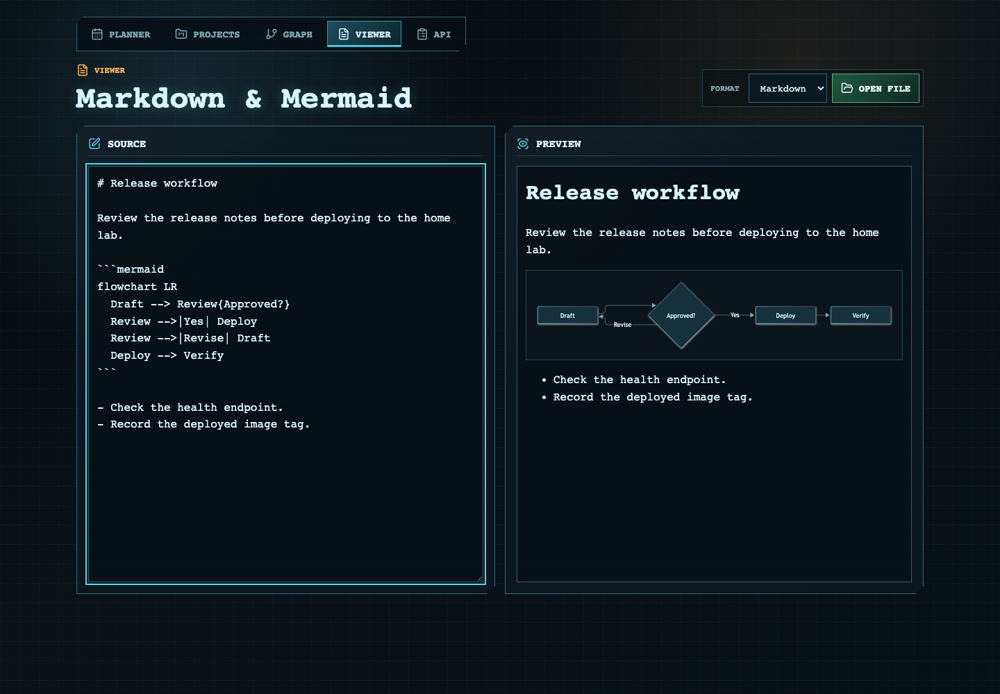
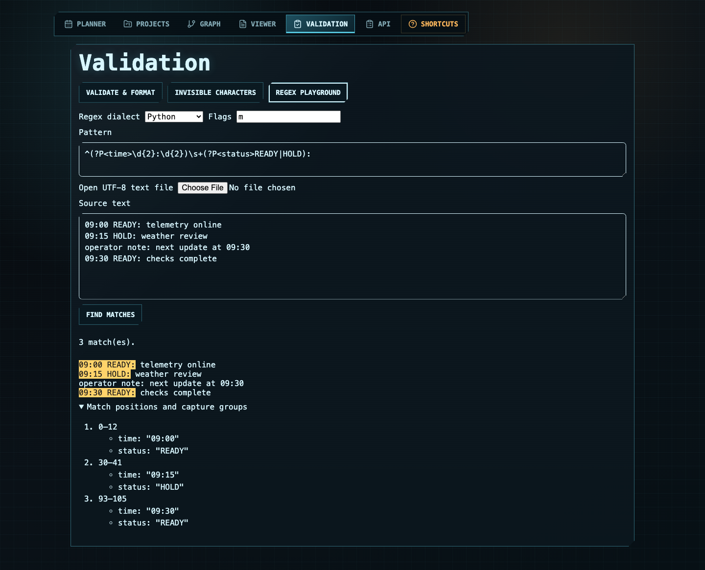

# Day Planner

Day Planner is a personal productivity suite for daily planning, project
management, graph notes, document previews, and text validation. The browser
app brings these tools together in one navigation bar. Planner and Projects
also share their PostgreSQL data with the Textual terminal app.

## Quickstart

Start Docker and run either option from the repository root. Both build and
start the same Compose stack, including PostgreSQL and a one-shot migration.

**With Just**

```bash
test -f .env || cp .env.example .env
just host-start
```

**Without Just**

```bash
test -f .env || cp .env.example .env
docker compose up --build -d
```

Open `http://localhost:8080` and use the top navigation. If you change
`DAILY_PLANNER_PORT` in `.env`, use that port instead. Stop the stack with
`just host-down` or `docker compose down`. Both keep the database volume.
For Podman, source-based development, or a local backup, see the
[local development and data guide](docs/development.md).

## Modules

### Planner

Plan a day with a schedule, three priorities, five tasks, and notes. Link a
project card to a dated priority and open it directly from the planner. The
[Planner guide](docs/planner.md) covers the web and terminal workflows.

### Projects

Organize work into epics, features, stories, and subtasks. Use the board,
calendar, timeline, or Gantt view to track work and dependencies. The
[Projects guide](docs/projects.md) covers cards, CSV imports, and shortcuts.

### Graph

Arrange Markdown notes on a visual canvas, connect related ideas, and attach
reference files. The [Graph guide](obsidian-arrow/README.md) covers the hosted
workspace, standalone browser storage, and import and export.

### Viewer

Preview Markdown and Mermaid diagrams from pasted source or local files.
The [Viewer guide](viewer/README.md) covers diagram presets, preview navigation,
and the programmatic preview API.

### Validation

Check and format JSON, XML, YAML, and TOML, inspect and selectively remove
invisible characters, or highlight regex matches in Python and JavaScript.
The [Validation guide](docs/validation.md) includes examples and API and MCP
request details.

### API and MCP

The **API** tab links to the suite's [REST and OpenAPI reference](docs/api.md).
The [MCP guide](docs/mcp.md) explains how to use the same tools from local
LLM clients and how to connect an eligible ChatGPT workspace.

### Shortcuts

Select **Shortcuts** in the shared navigation for web and terminal keybindings.
The [Planner](docs/planner.md#terminal-shortcuts) and
[Projects](docs/projects.md#web-shortcuts) guides list their controls.

## Development and deployment

The [Just recipe guide](docs/just.md) lists commands for local hosting,
development, tests, screenshots, and recovery. The
[k3s deployment runbook](deploy/k3s/README.md) covers release images,
migration checks, TLS, backups, and rollback. See the
[architecture overview](ARCHITECTURE.md) for how the components fit together
and the [roadmap](docs/roadmap.md) for planned work.

## Screenshots






The module guides contain the remaining screenshots, including the Gantt
chart, Graph wiki, syntax diagnostics, character cleanup, and API Reference.
