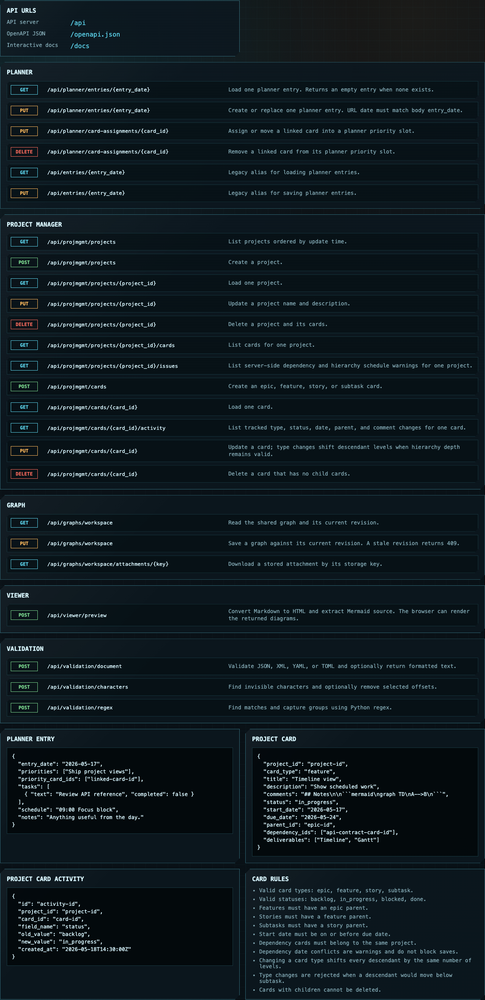

# API reference

Open **API** at `/?view=api` for the in-app reference. Visit `/docs` for
interactive OpenAPI documentation or `/openapi.json` for the schema. The
table highlights common endpoints. The schema lists the full interface.

| Method | Path | Description |
| --- | --- | --- |
| `GET` | `/api/search?q=term` | Search Planner, Projects, and hosted Graph |
| `GET` | `/api/planner/entries/{entry_date}` | Load a planner entry by `YYYY-MM-DD` date |
| `PUT` | `/api/planner/entries/{entry_date}` | Save a planner entry for that date |
| `PUT` | `/api/planner/card-assignments/{card_id}` | Assign or move a card into a dated planner priority slot |
| `DELETE` | `/api/planner/card-assignments/{card_id}` | Remove a linked card assignment from the planner |
| `GET` | `/api/graphs/workspace` | Load the shared graph and its current revision |
| `PUT` | `/api/graphs/workspace` | Save a graph and any new files using the current revision |
| `GET` | `/api/graphs/workspace/attachments/{key}` | Download a stored attachment |
| `POST` | `/api/viewer/preview` | Prepare Markdown HTML and extract Mermaid diagram source |
| `POST` | `/api/validation/document` | Check document syntax and optionally return formatted text |
| `POST` | `/api/validation/characters` | Find invisible characters and optionally remove selected offsets |
| `POST` | `/api/validation/regex` | Return matches and capture spans using Python regex |
| `POST` | `/api/validation/sql` | Format or translate SQL, including Snowflake and BigQuery |
| `POST` | `/api/validation/schema` | Check JSON against Draft 2020-12 and report issue paths |
| `POST` | `/api/validation/xml-schema` | Check XML against a self-contained XSD 1.0 schema |
| `POST` | `/api/validation/config-diff` | Format and compare JSON or YAML |
| `GET` | `/api/projmgmt/projects` | List projects |
| `POST` | `/api/projmgmt/projects` | Create a project |
| `DELETE` | `/api/projmgmt/projects/{project_id}` | Delete a project and its cards |
| `GET` | `/api/projmgmt/projects/{project_id}/cards` | List project cards |
| `GET` | `/api/projmgmt/projects/{project_id}/issues` | List server-side dependency and hierarchy schedule warnings |
| `POST` | `/api/projmgmt/cards` | Create an epic, feature, story, or subtask |
| `PUT` | `/api/projmgmt/cards/{card_id}` | Update a card |
| `DELETE` | `/api/projmgmt/cards/{card_id}` | Delete a card |

## Conventions

- Planner entry URLs and project dates use `YYYY-MM-DD`.
- Graph saves send the current workspace revision. Reload or reconcile edits
  when a stale write returns HTTP 409.
- Viewer returns HTML and Mermaid source for the client to render. See the
  [Viewer guide](../viewer/README.md).
- Validation returns structured diagnostics, including line and column when
  available. See the [Validation guide](validation.md) for request details.
- The [MCP guide](mcp.md) describes tool discovery, local transports, and
  ChatGPT connection options.

