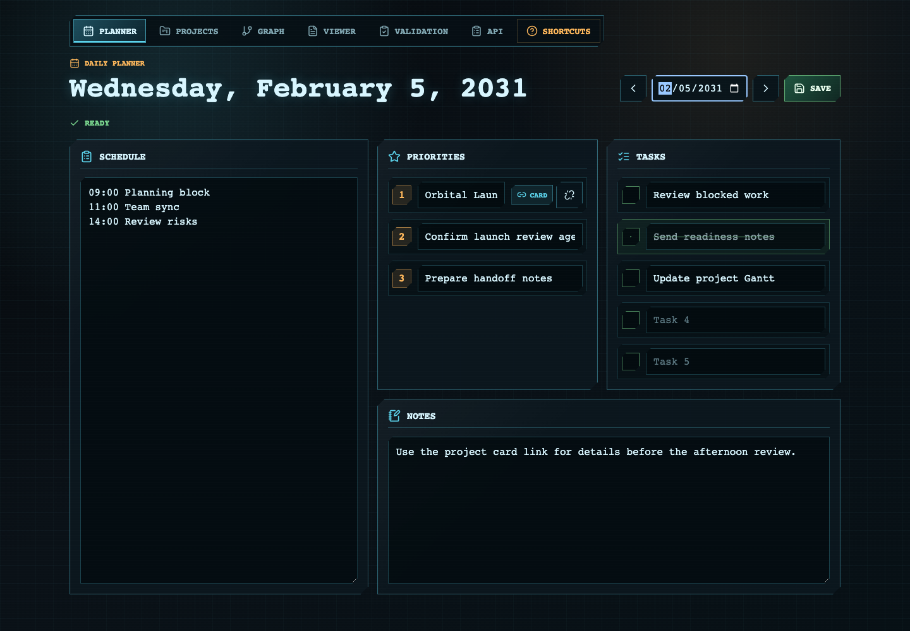
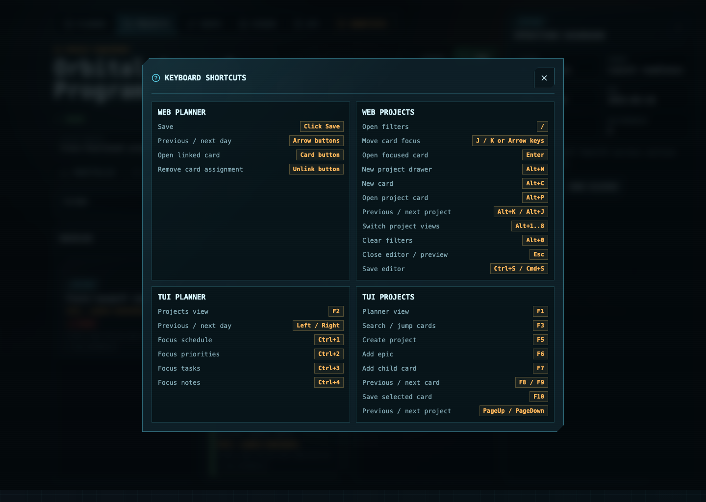

# Planner

Open **Planner** at `/` for a daily schedule, three priorities, five tasks,
and notes. Change days with the date picker or arrows. Select **Save** to
persist web edits. The browser and Textual terminal app share the configured
PostgreSQL database.

## Linked project priorities

Assign a project card from its editor in Projects. The planner priority's
**Card** control opens the linked item, and the unlink control removes the
assignment. Moving the card to a different date removes the former link.
See [Projects](projects.md) for assignment and scheduling details.

## Terminal planner

Run `just tui` from the repository root after starting PostgreSQL.
See [local development](development.md) for the standalone executable and
the command without `just`.

## Terminal shortcuts

| Key | Action |
| --- | --- |
| `F2` | Switch to project management |
| `Left Arrow` | Save the current day and move to the previous day |
| `Right Arrow` | Save the current day and move to the next day |
| `Ctrl+1` | Focus the schedule section |
| `Ctrl+2` | Focus the first priority field |
| `Ctrl+3` | Focus the first task field |
| `Ctrl+4` | Focus the notes section |

`Ctrl+M` is also supported as an alternate project-management shortcut, but `F2` is more reliable across terminal emulators.

Entries are saved when changing days and when the app exits.

## Screenshots

