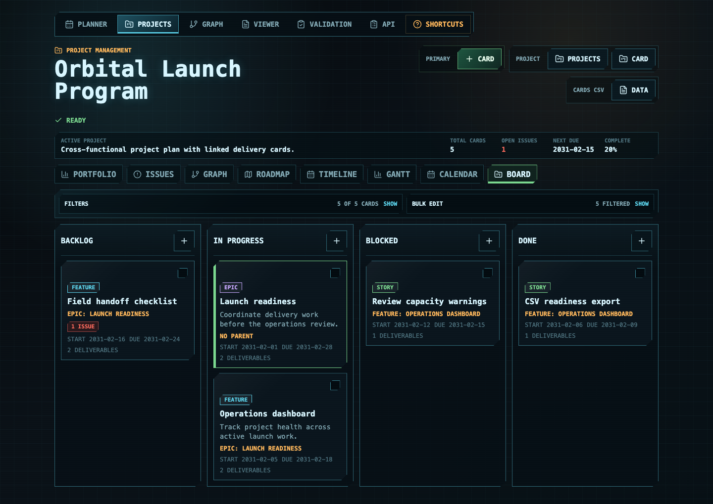
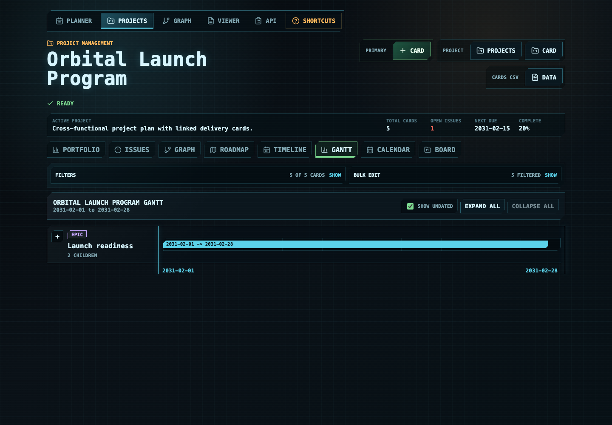
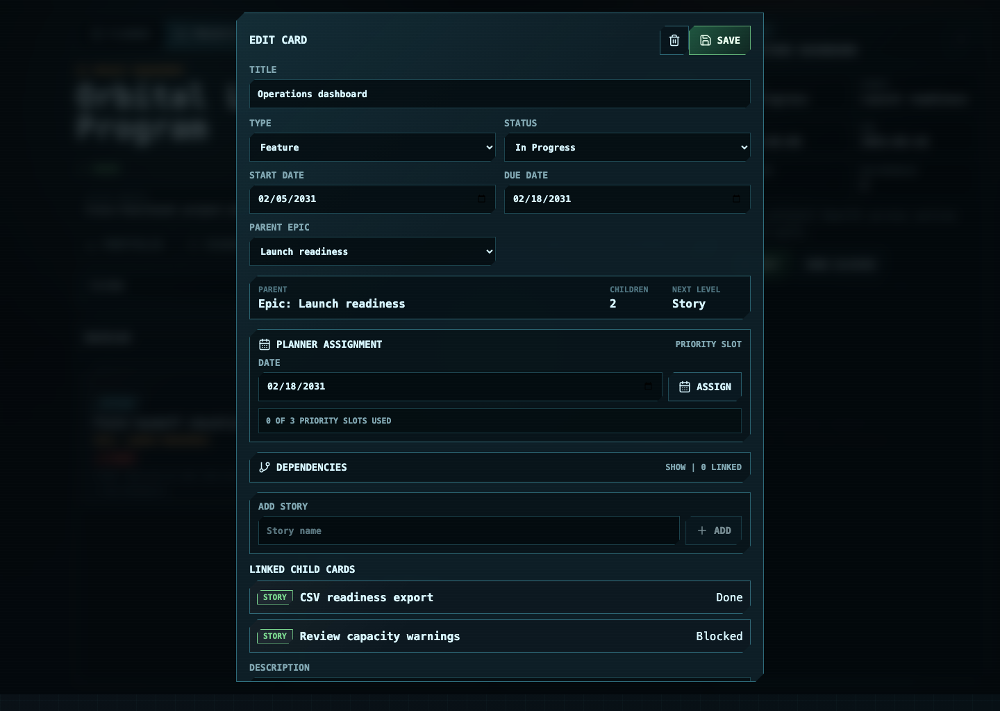

# Projects

Open **Projects** at `/?view=projects` to manage work in portfolio, roadmap,
timeline, Gantt, calendar, and board views. Drag cards between Kanban columns
to update their status. Card comments support Markdown and Mermaid blocks.
Select **Shortcuts** for keyboard help.

## Project cards

Project cards follow this hierarchy:

```text
Project
  Epic
    Feature
      Story
        Subtask
```

In the Projects tab, opening a project card shows linked epics and an inline field for adding epics without leaving the project card. Opening an epic, feature, or story card shows its parent, child cards, valid parent choices, and an inline field for adding the next child type. Type a child card name and press `Enter` or click `Add`; the child is added to the list and the parent card stays open so multiple child cards can be created quickly. The API enforces the same hierarchy, so a story must be tied to a feature and a subtask must be tied to a story.

Assigning a project card to a planner date creates a linked priority entry. Assigning the same card again moves that priority assignment to the new date. The card editor shows how many priority slots are already used for the selected date, warns when the day is full, and surfaces when multiple linked cards are already assigned to that date. In the web planner, the small linked-card control opens its project card and the adjacent unlink control removes the assignment.

The Cards CSV panel exports the active project's cards, downloads a blank import template, and imports cards from CSV. Imports are validated before any cards are created: row-level errors are shown in the side panel for missing parents, unsupported types or statuses, invalid date ranges, duplicate imported card IDs, and unresolved dependencies. Parent and dependency links can reference existing or imported cards by ID, or by title when the title is unambiguous. If an API failure happens after card creation starts, the web app attempts to roll back the cards created by that import and reloads the project.

Project hierarchy, dependency, and schedule-warning rules are implemented server-side in the project management service layer. The web UI keeps matching local domain helpers for responsive rendering, and the API exposes project issue results for clients that need the server as the source of truth.

## Graph runbooks and templates

In the card editor, select **Choose a Graph note** and choose a note from the
hosted Graph workspace. Save the card to keep the link. **Open Graph runbook**
opens the selected note in another tab from the editor or card preview.
If a note is removed from Graph, you can clear or replace its link in
the card editor. Planner and Projects JSON backups retain the link ID.
A full PostgreSQL backup also includes the linked Graph data.

When creating a card, choose **Service upgrade**, **Restore rehearsal**, or
**Incident follow-up**, then select **Apply template**. A template fills
blank title and description fields and adds its deliverables to the draft.
Review the draft and save the card when it is ready.

## Terminal controls

| Key | Action |
| --- | --- |
| `F1` | Switch to planner |
| `F5` | Create a project from the project name and description fields |
| `F6` | Add a backlog epic to the selected project |
| `F7` | Add the next child type to the selected card |
| `F3` | Focus card search; type text to filter or a card number to jump |
| `F10` | Save edits to the selected card |
| `PageUp` / `PageDown` | Select the previous or next project |
| `F8` / `F9` | Select the previous or next card |

The previous `Ctrl+P`, `Ctrl+N`, `Ctrl+E`, `Ctrl+A`, `Ctrl+F`, `Ctrl+Up` / `Ctrl+Down`, and `Ctrl+K` / `Ctrl+J` shortcuts remain available as alternates. In the TUI project view, select an epic and press `F7` to add a feature, select a feature and press `F7` to add a story, or select a story and press `F7` to add a subtask. Deliverables can be entered as a comma-separated list before adding a card.

The selected-card edit form updates as you move through cards with `F8` and `F9`. Use `F3` to filter cards by title, type, status, or parent name; enter a card number and press `Enter` to jump directly to that card. Edit the title, description, comments, status, start date, due date, parent number, or deliverables, then press `F10` to save. Status values are `backlog`, `in_progress`, `blocked`, and `done`. Dates use `YYYY-MM-DD`. Feature, story, and subtask cards require a parent number from the eligible parent list shown under the edit form.

## Web shortcuts

Open the in-app shortcut reference with **Shortcuts** or by pressing `?`.

| Key | Action |
| --- | --- |
| `/` | Open filters |
| `J` / `K` or arrow keys | Move card focus |
| `Enter` | Open the focused card |
| `Alt+N` | Open the project switcher and focus the new project field |
| `Alt+P` | Open the active project card |
| `Alt+C` | Open the new card editor |
| `Alt+J` or `Alt+Down` | Select the next project |
| `Alt+K` or `Alt+Up` | Select the previous project |
| `Alt+1` through `Alt+8` | Switch project views |
| `Alt+0` | Clear project filters |
| `Esc` | Close the open card editor |
| `Ctrl+S` / `Cmd+S` | Save the open card editor |

Project shortcuts are ignored while typing in form fields. Deleting a project requires confirmation and removes its cards.

## Screenshots






