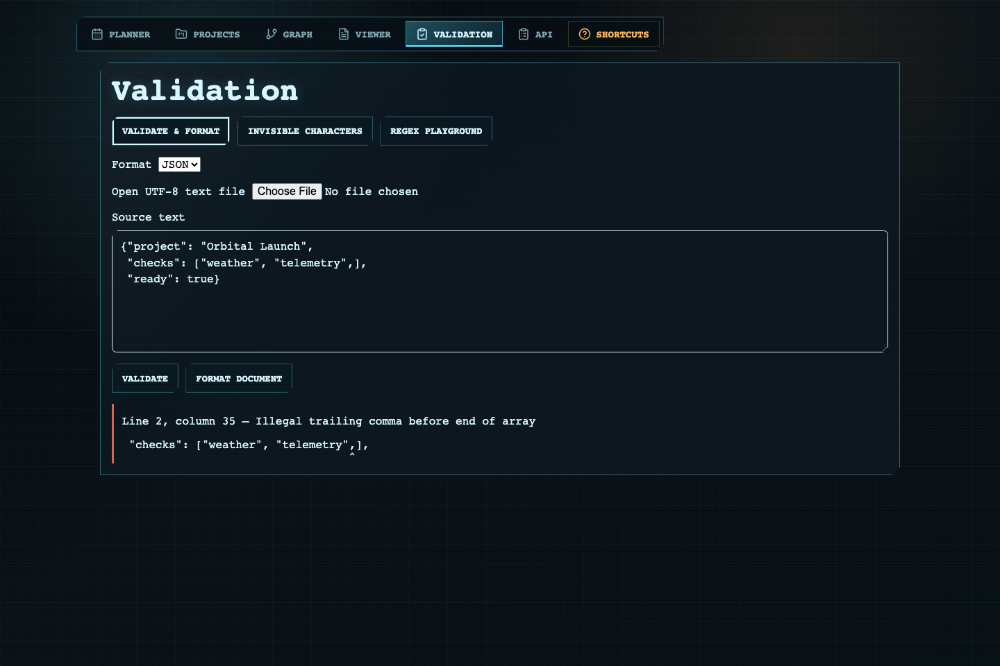
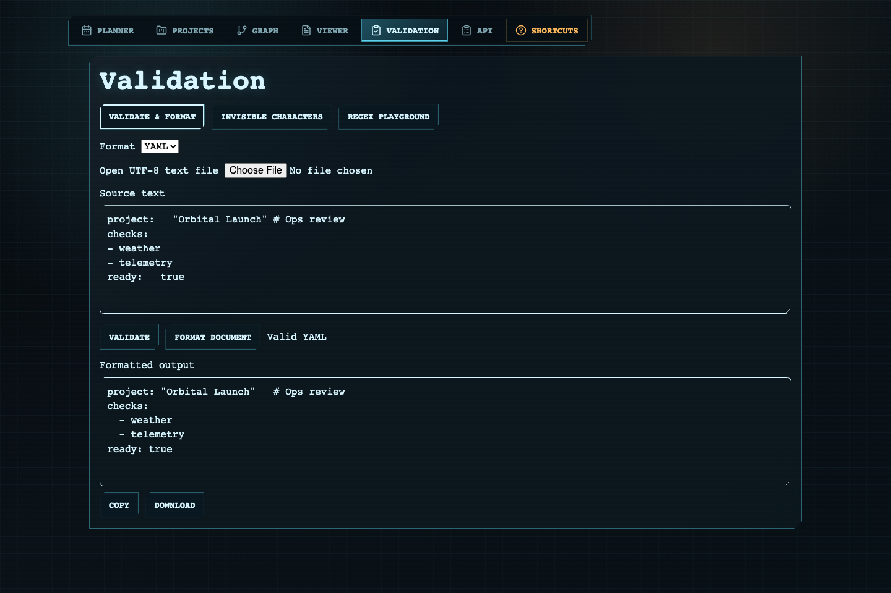
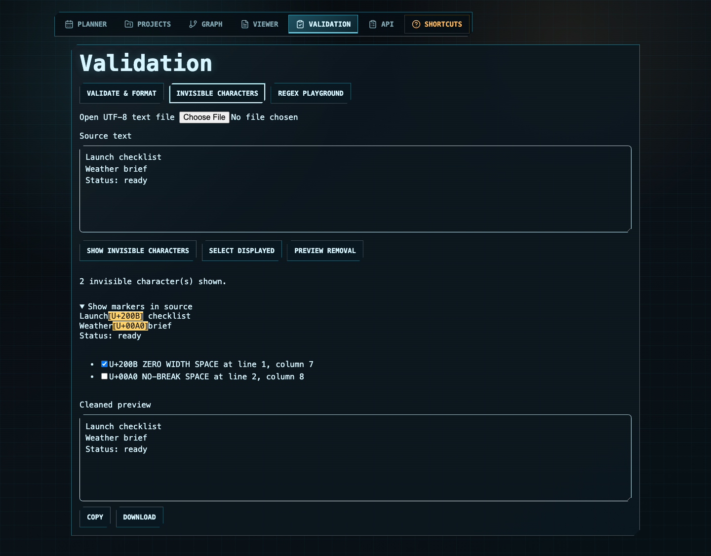
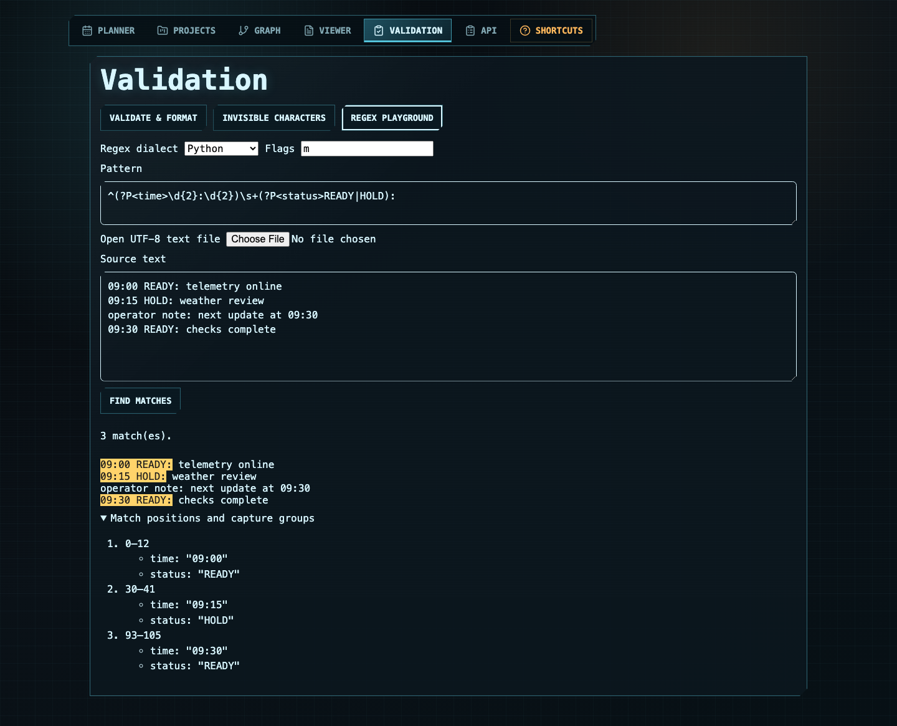

# Validation

Open **Validation** in Day Planner. Each tool keeps its draft while you switch
between tools. Paste text or open a UTF-8 file. Formatting and cleanup produce
separate previews that you can copy or download.

- **Validate & Format** checks JSON, XML, YAML, and TOML syntax. Errors show a
  line and column when the parser provides one. JSON formatting preserves number
  and string spellings. YAML and TOML formatting preserves comments and key
  order. XML preserves existing text and mixed content. The XML parser rejects
  DTDs and custom entity declarations.
- **Invisible Characters** finds control characters, formatting characters,
  unusual spaces, and Unicode line and paragraph separators. Tabs, ordinary
  spaces, and CR/LF are kept. Review the marked source or select individual
  findings to preview their removal.
- **Regex Playground** starts with Python's standard `re` syntax. Switch to
  JavaScript for browser regexes. Enter a pattern without slash delimiters.
  Matches include zero-width positions and captures. Python supports
  `a`, `i`, `m`, `s`, and `x`, plus inline flags. JavaScript finds all
  matches and uses a browser worker. Either runner stops after one second.

Document checks, character inspection, Python regex, SQL, and schema checks send the input to
your Day Planner API. The API processes it in memory. JavaScript regex runs
in the browser. Sources have a 100,000-character limit, regex patterns a
2,000-character limit, and match results a 200-match limit.

## SQL translation and formatting

Select **SQL Translate & Format**, paste SQL or open a UTF-8 file, and pick
the source dialect. **Format SQL** keeps that dialect. **Translate SQL**
uses the target selector and shows the output beside your source. Supported
dialects are PostgreSQL, SQLite, DuckDB, MySQL, Snowflake, and Google BigQuery.

SQLGlot parses and generates SQL text in the API process. Syntax errors show
the parser's location when available. Reported unsupported translations
stop with a diagnostic, and unverified function names appear in a warning.
Review the output for dialect-specific or schema-dependent behavior before
using it in your database.

## JSON Schema

Select **JSON Schema**, enter the document and a Draft 2020-12 schema, and
choose **Check against schema**. Results identify the input and path, such
as `$.items[2].dueDate`. The checker supports inline references such as
`#/$defs/item`. External schema URLs are unavailable. The checker has a
two-second time limit and returns up to 50 issues. The `format` keyword is
treated as an annotation.

## XML Schema

Select **XML Schema**, enter the XML document and a self-contained XSD 1.0
schema, then choose **Check against schema**. Results identify the XML or XSD
input, the element path, and the line and column when available. You can
paste either input or open it from a UTF-8 file.

The checker rejects DTDs, custom entity declarations, and external schema
locations. It runs with a two-second time limit and returns up to 50 issues.

## Config Diff

Choose **Config Diff**, select JSON or YAML, and paste or open your before
and after files. **Compare configs** formats both inputs and aligns their
lines. The red and green cells show removed and added text. **Hide unchanged
lines** shows only the differences. Invalid input is labeled Before or After
and includes the formatter's diagnostic.

The comparison removes formatting noise such as inconsistent spacing.
Key order and comments can still appear as differences. Each side can have
up to 1,000 formatted lines.

## API and MCP

| HTTP endpoint | MCP tool | Main inputs |
| --- | --- | --- |
| `POST /api/validation/document` | `validate_document` | `format`, `source`, optional `pretty` |
| `POST /api/validation/characters` | `inspect_invisible_characters` | `source`, optional `remove_offsets` |
| `POST /api/validation/regex` | `find_python_regex_matches` | `pattern`, `source`, optional `flags` |
| `POST /api/validation/sql` | `translate_sql_text` | `source`, `source_dialect`, optional `target_dialect` |
| `POST /api/validation/schema` | `check_json_schema` | `source`, `schema_source` |
| `POST /api/validation/xml-schema` | `check_xml_schema` | `source`, `schema_source` |
| `POST /api/validation/config-diff` | `compare_config_text` | `format`, `left`, `right` |

HTTP accepts a JSON body containing the main inputs. MCP takes those same
inputs under `request`. Syntax errors and regex timeouts return a structured
`diagnostic`. Locations are 1-based. Character offsets and Python regex spans
are zero-based Unicode code-point offsets. Match ends are exclusive.
Unmatched captures are null.

See the suite's API Reference or `/docs` for request and response schemas and
the [MCP setup guide](mcp.md) for client configuration.

## Screenshots

