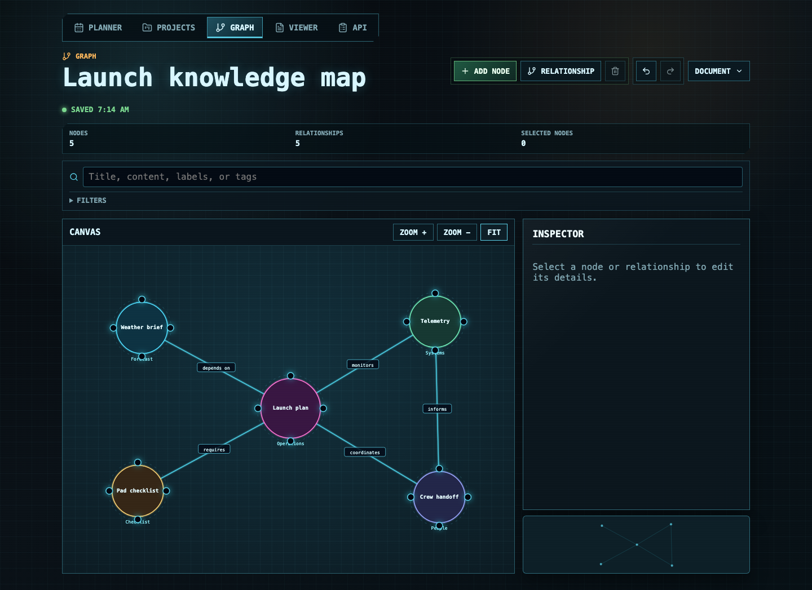
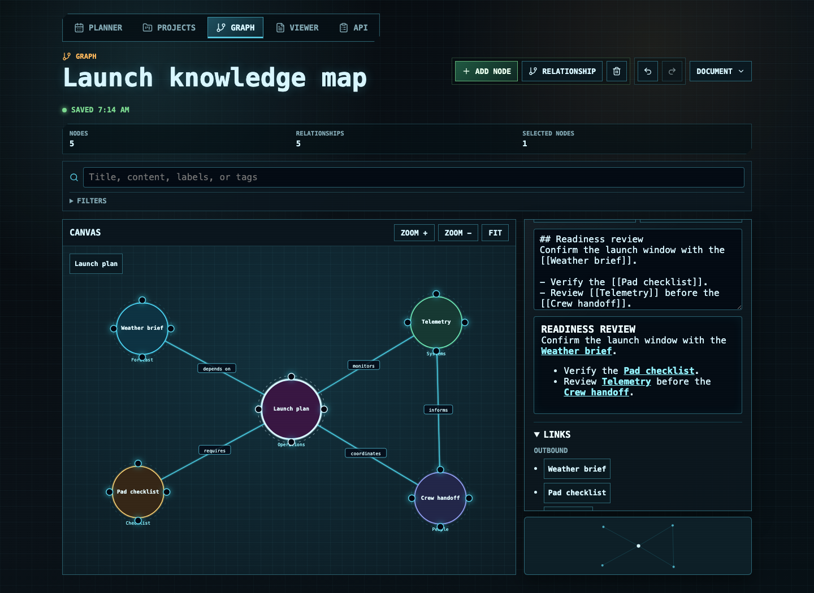

Local Graph Wiki
================

A local-first visual graph and wiki application inspired by arrows.app. It runs
in the browser with React, TypeScript, Vite, and an SVG graph canvas. The
combined project serves Graph at `/graph/` inside the Day Planner suite.
See the [root README](../README.md#quickstart) for Compose and the [k3s guide](../deploy/k3s/README.md) for deployment.

## Hosted Graph

Open **Graph** from the web navigation or go directly to `/graph/`. Use it to
organize notes and reference material as nodes, then draw relationships to show
how they connect.

- Write node content in Markdown, link to other nodes, and follow backlinks.
- Attach reference files and find nodes by title, content, label, or tag.
- Pan and zoom the canvas, use the minimap, and arrange groups of nodes in a grid or circle.

Hosted Graph autosaves one shared graph and its attachments to Postgres. Open
the same deployment from another browser to pick up where you left off. If a
stale tab tries to save over a newer revision, Graph asks you to export your
edits and reload. The standalone version stores data in the browser.

The workspace summary shows node, relationship, and selection counts. Use the
search and filters above the canvas to find nodes. Open **Document** to rename
the graph or find the import, export, and backup actions. Use
**Export backup** to make a portable copy with attachment files and **Import JSON**
to bring it into a deployment. **Export JSON** carries the graph
and attachment metadata. Hosted attachments can be up to 10 MiB each, and a
single save or import request can be up to 24 MiB. See the
[migration steps](../deploy/k3s/README.md#move-an-existing-graph) for existing graphs.





Standalone development
----------------------

```bash
just install
just dev
```

Then open the local URL printed by Vite.

Run with Docker
---------------

From `obsidian-arrow/`, build and serve the standalone app on port `8080`:

```bash
just docker-up-detached
```

Then open `http://localhost:8080`. To expose a different host port:

```bash
ARROWSAPP_PORT=8090 docker compose up --build
```

For LAN access, open `http://<host-machine-ip>:8080` from another machine on the same network.

From the repository root, `just host-start obsidian-arrow` starts the standalone
Compose service on port `8081` by default. Use the same origin where you saved
the graph when recovering browser data.

Backup and migration
--------------------

Open **Document** for the import and export actions.

Standalone Graph stores the graph in `localStorage` and attachment bytes in
IndexedDB, scoped to the browser profile and origin. Hosted Graph at `/graph/`
saves to Postgres through the shared API. On the old URL, select
**Export backup** to include the graph and its attachment files. On the new URL,
select **Import JSON** to replace the open graph with that backup. **Export JSON**
exports the graph and attachment metadata alone. Hosted Graph and its files
are included in a full Postgres dump.

Developer shortcuts
-------------------

The `Justfile` in this directory manages standalone Graph development:

```bash
just install
just dev
just build
just docker-up
just docker-down
```

Run `just` to list every available recipe.

From the repository root, use `just graph-dev` for standalone hot reload or
`just graph-build` to build the bundle for the combined `/graph/` route.

Build it
--------

```bash
npm run build
```

Architecture
------------

- `src/types/graph.ts` defines the stable graph document, node, relationship, and attachment model.
- `src/lib/graphOps.ts` contains pure graph operations for creating, updating, moving, connecting, and deleting graph entities.
- `src/lib/storage.ts` owns local save/load plus JSON import/export helpers.
- `src/lib/sqlite.ts` maps the browser JSON document model to SQLite row snapshots.
- `src/lib/tauriStorage.ts` defines a Tauri command-backed storage adapter for SQLite documents and filesystem attachments.
- `src/lib/search.ts` searches node titles, labels, tags, and markdown content.
- `src/components/GraphCanvas.tsx` renders the SVG graph and handles drag/select interactions.
- `src/components/InspectorPanel.tsx` edits selected node or relationship metadata.
- `src/components/MarkdownEditor.tsx` provides a lightweight markdown editor and preview.

Next steps
----------

See [todo.md](todo.md) for planned work.
