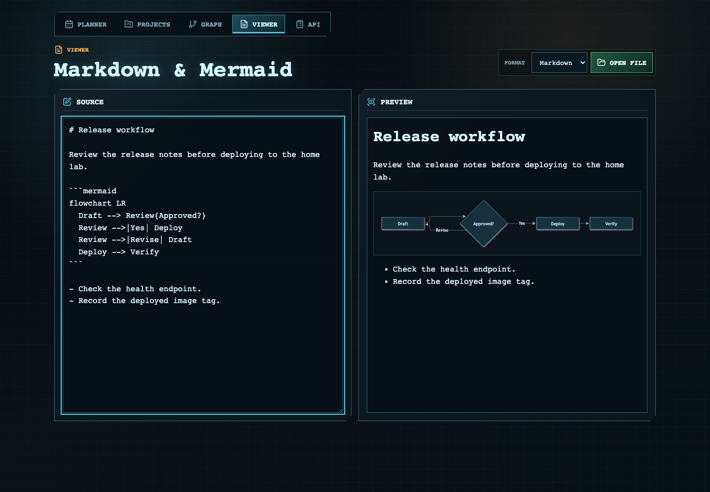

# Viewer

Open **Viewer** from the web navigation or go to `/viewer/`. It starts in
**Mermaid** with a rendered flowchart. Use **Diagram type** to load an editable
example, such as a sequence diagram, Gantt chart, or mind map. Edits stay in
their own draft while you switch diagram types or formats in the open tab.
Use **Expand preview** in the Preview header to span both panes. Select
**Restore split view** or press `Esc` to bring the editor back.
Use the zoom buttons or `Ctrl`/`Cmd` + scroll to zoom the preview. Turn on
**Pan preview** and drag to scan around it. **Fit** resets the view and shrinks
a tall standalone diagram to fit the pane.

Select **Markdown** or open a local `.md` file for a live Markdown preview.
Use a `mermaid` or `mmd` fenced code block to embed a diagram. Open an `.mmd`
or `.mermaid` file to preview its source as a standalone diagram.

The viewer renders in the browser and does not upload or save your source.
Raw HTML and external images are disabled in the preview. Keep your source in
a local file if you want to use it again.

## Generate QR codes and barcodes

Choose **QR Code** from **Format** and enter text or a URL up to 2,000 UTF-8
bytes. Choose **Barcode (Code 128)** for up to 80 printable ASCII characters,
such as an asset ID. Both formats generate live in the browser and preserve
spaces in the input.

## Export graphics

Select **Download SVG** for a vector image or **Download PNG** for a raster
image. Code previews and Mermaid diagrams have their own controls, including diagrams
inside Markdown. Export runs in the browser and uses the rendered diagram's
dimensions regardless of preview zoom. PNG exports use the preview background
and are capped at 4,096 pixels on the longest side.

## Export or print a document

Select **Download HTML** to save the rendered preview as a self-contained
file. Generated graphics are embedded and available offline. Other image
references are replaced with their alt text. Open **Print preview** to print
the rendered document or use your browser's **Save as PDF** destination.
The editor and navigation controls are hidden in the print layout.

## Development and API

From the repository root, `just viewer-dev` starts the standalone Vite
development server and `just viewer-build` builds the hosted bundle. Without
`just`, use `npm --prefix viewer ci` and then `npm --prefix viewer run dev`
or `npm --prefix viewer run build`.

The browser UI renders local drafts. Programmatic clients can send Markdown
or Mermaid source to `POST /api/viewer/preview`. It returns Markdown HTML
and the Mermaid source for client-side rendering. See the [API guide](../docs/api.md)
and [MCP tools](../docs/mcp.md).

